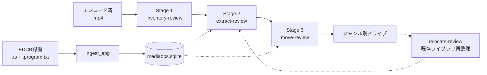

# video-library-pipeline

EDCB録画ファイルをエンコード後のMP4として受け取り、メタデータ抽出・ヒューマンレビュー・ジャンル別ドライブ振り分けまでを一貫して行うOpenClawプラグイン。

WSL2上のPython/TypeScriptと、Windows側のPowerShell 7を協調させ、SQLiteデータベースで全操作を追跡する。

## Documentation

READMEは入口だけを保持し、詳細な設計判断はADRへ分割している。

- [docs/CURRENT_SPEC_INDEX.md](docs/CURRENT_SPEC_INDEX.md): 現行仕様の読み順と情報源マッピング
- [docs/adr/README.md](docs/adr/README.md): ADR一覧
- [docs/adr/0002-pipeline-architecture-and-review-gates.md](docs/adr/0002-pipeline-architecture-and-review-gates.md): 全体パイプライン、Stage、Skillフロー
- [docs/adr/0003-windows-powershell-filesystem-boundary.md](docs/adr/0003-windows-powershell-filesystem-boundary.md): WSL2/Windows境界、PowerShellスクリプト、長パス対応
- [docs/adr/0004-tool-orchestration-and-follow-up-calls.md](docs/adr/0004-tool-orchestration-and-follow-up-calls.md): V1 legacy tool orchestration、followUpToolCalls、LLMサブエージェント
- [docs/adr/0005-metadata-and-artifact-lifecycle.md](docs/adr/0005-metadata-and-artifact-lifecycle.md): JSONL/YAML、`windowsOpsRoot`、source遷移
- [docs/adr/0006-mediaops-db-routing-and-safety.md](docs/adr/0006-mediaops-db-routing-and-safety.md): DBスキーマ、ジャンルルーティング、安全機構
- [docs/adr/0007-openclaw-sdk-recommended-plugin-implementation.md](docs/adr/0007-openclaw-sdk-recommended-plugin-implementation.md): OpenClaw SDK公式docsに基づくplugin推奨実装方針
- [docs/adr/0008-v2-workflow-kernel-and-run-based-tool-surface.md](docs/adr/0008-v2-workflow-kernel-and-run-based-tool-surface.md): V2 run-based workflow kernel と公開tool surface

既存/追加要件の背景は以下にも残っている。現行動作かどうかは必ず [docs/CURRENT_SPEC_INDEX.md](docs/CURRENT_SPEC_INDEX.md) を起点に確認する。

- [FLOW_AND_OWNERSHIP.md](FLOW_AND_OWNERSHIP.md)
- [DEPENDENCIES.md](DEPENDENCIES.md)
- [MULTIDRIVE_EPG_REQUIREMENTS.md](MULTIDRIVE_EPG_REQUIREMENTS.md)
- [BACKFILL_MOVED_FILES_REQUIREMENTS.md](BACKFILL_MOVED_FILES_REQUIREMENTS.md)
- [DUPLICATE_DEDUP_REQUIREMENTS.md](DUPLICATE_DEDUP_REQUIREMENTS.md)

## Repository Map

- `src/plugin/`: OpenClaw plugin登録、CLI、plugin hook
- `src/tools/`: `video_pipeline_*` ツールアダプタ
- `src/platform/`: 設定解決、ランタイム、PowerShellテンプレート同期
- `src/core/`: ツール間で共有するTypeScript実行ロジック
- `src/contracts/`: TypeScript側の共通型
- `py/*.py`: 現行の実行エントリポイントと互換ラッパー
- `py/video_pipeline/domain|db|platform/`: Python共有ロジックの本体
- `templates/windows-scripts/`: プラグイン同梱のPowerShellテンプレート本体
- `assets/windows-scripts/`: 移行期間中のレガシーフォールバック
- `skills/*/SKILL.md`: OpenClaw AIエージェント向けの実行ガイド
- `docs/adr/`: 設計判断の記録

`src/*.ts` と `py/*.py` の一部は後方互換のために残っている薄いラッパーであり、新規実装の配置先ではない。

## Architecture Summary



V2 の公開 OpenClaw tool surface は次の4つ。

- `video_pipeline_start`: `flow` を指定して run を開始する。
- `video_pipeline_resume`: `runId` と `nextActions` に対応する action で既存 run を継続する。
- `video_pipeline_status`: run 単位または recent runs / open gates / latest artifacts を確認する。
- `video_pipeline_inspect_artifact`: `runId` + `artifactId` で artifact metadata、checksum、preview、関連 gate を確認する。

主要 V2 flow は次の2つ。

- sourceRootフロー: 未視聴フォルダを棚卸し、メタデータ抽出とレビューを経てジャンル別ドライブへ移動する。
- relocateフロー: 既存ライブラリをスキャンし、メタデータ不足を補完して正しいフォルダ構成へ再配置する。

## Operational Guardrails

- ステージ間にヒューマンレビューゲートを置き、`needs_review=true` のファイルはデフォルトで移動対象から除外する。
- 物理操作は run-scoped plan artifact をレビューし、`video_pipeline_resume` で実行する。
- Windowsファイル操作はWSL2から直接行わず、PowerShell 7テンプレートへ委譲する。
- V2 操作では `runId`, artifact IDs, `ReviewGate`, `nextActions` を source of truth にする。
- `source=human_reviewed` は確定データ、`source=llm` はsuspicious titleチェック通過時のみ移動可能な推測データとして扱う。

詳細はADRを参照。

## Prerequisites

| 要件 | 詳細 |
|---|---|
| OS | WSL2 on Windows 11 |
| PowerShell | 7.x (`pwsh`) |
| Python | 3.10+ (`uv`でパッケージ管理) |
| Windows設定 | `LongPathsEnabled = 1` |
| 外部ツール | `czkawka-cli` OpenClawプラグイン |
| DB | SQLite 3 |

## Development

TypeScriptプラグイン層はVitest、Python実行層はpytestで検証する。

```bash
npm test
pytest
```

OpenClaw SDK testing方針の詳細は [docs/adr/0001-plugin-sdk-testing.md](docs/adr/0001-plugin-sdk-testing.md) を参照。

## OpenClaw runtime の Python 環境

plugin 内に仮想環境を置くと、interpreter の外部リンクが OpenClaw の companion 境界検査に抵触する。OpenClaw からの uv 呼出しは `~/.openclaw/plugin-runtime/video-library-pipeline/.venv` を使用する（`OPENCLAW_STATE_DIR` があればその配下）。環境の場所を変える場合は `OPENCLAW_VIDEO_PIPELINE_VENV` を指定する。ほかのコマンドやプロジェクトの環境変数は変更しない。

開発時も同じ場所を指定し、linked plugin の repo 内に `.venv` や外部環境へのリンクを再作成しない。

```sh
UV_PROJECT_ENVIRONMENT="$HOME/.openclaw/plugin-runtime/video-library-pipeline/.venv" uv sync --locked
```

## v0.3.0: 日次CLIと安全な配布

モデルを呼ばずにEPG取り込みから整理まで進めるCLIを追加した。メタデータレビューは自動承認しない。衝突・更新中ソース・保留対象を除外し、移動先を上書きしない。場所とファイルのIDを分離し、移動記録の再反映は冪等にする。詳細は [ADR 0009](docs/adr/0009-deterministic-execution-and-file-identity.md)。

```sh
# DBコピーでプレビュー。動画の移動はしない。
openclaw video-pipeline-organize
# プレビューを確認して、安全な候補だけを実行。
openclaw video-pipeline-organize --apply
# scheduler向け: 成功は無言、変更/失敗だけ通知、失敗は非0終了。
openclaw video-pipeline-organize --apply --scheduled
```

`sourceRoot`, `destRoot`, `windowsOpsRoot`, `tsRoot`, `driveRoutesPath`をplugin configへ設定する。DBは既存SQLiteを指定するか、`windowsOpsRoot/db/mediaops.sqlite`へ用意する。`rules/drive_routes.example.yaml`の例示パスは自分の環境に合わせて変更する。存在しない振り分け設定はエラーになる。

`rules/program_aliases.example.yaml`は空の公開辞書。ローカルの`rules/program_aliases.yaml`があれば優先するが、個人の番組名・元ファイル名・閲覧履歴を含み得るため配布しない。自動抽出はルール/辞書/EPGであり、LLMによる抽出を装う記録はしない。

GitHub Releasesの配布tarballをダウンロードしてインストールする。

```sh
openclaw plugins install npm-pack:./nextaltair-video-library-pipeline-0.3.0.tgz
```

監査用のデータ修復は`openclaw video-pipeline-repair-history --help`を参照。既定でコピーDBを使い、`--apply`時は直前バックアップを作る。日次処理で過去データの修復や重複削除を勝手に実行しない。
