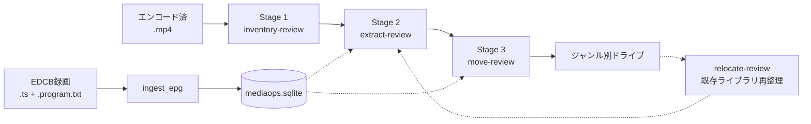

# video-library-pipeline

EDCB録画ファイルをエンコード後のMP4として受け取り、メタデータ抽出・ヒューマンレビュー・ジャンル別ドライブ振り分けまでを一貫して行うOpenClawプラグイン。

WSL2上のPython/TypeScriptと、Windows側のPowerShell 7を協調させ、SQLiteデータベースで全操作を追跡する。

## Documentation

READMEは入口だけを保持し、詳細な設計判断はADRへ分割している。

- [docs/CURRENT_SPEC_INDEX.md](docs/CURRENT_SPEC_INDEX.md): 現行仕様の読み順と情報源マッピング
- [docs/adr/README.md](docs/adr/README.md): ADR一覧
- [2026-10-10 設計監査と移行計画](docs/reviews/2026-10-10-design-audit.md): 次期設計の提案。現行仕様は変更しない
- [M0整合性修正](docs/adr/0012-m0-integrity-boundaries.md): 実装済みのmetadata検証・transaction・backup・排他・失敗判定
- [docs/adr/0002-pipeline-architecture-and-review-gates.md](docs/adr/0002-pipeline-architecture-and-review-gates.md): 全体パイプライン、Stage、Skillフロー
- [docs/adr/0003-windows-powershell-filesystem-boundary.md](docs/adr/0003-windows-powershell-filesystem-boundary.md): WSL2/Windows境界、PowerShellスクリプト、長パス対応
- [docs/adr/0004-tool-orchestration-and-follow-up-calls.md](docs/adr/0004-tool-orchestration-and-follow-up-calls.md): V1 legacy tool orchestration、followUpToolCalls、LLMサブエージェント
- [docs/adr/0005-metadata-and-artifact-lifecycle.md](docs/adr/0005-metadata-and-artifact-lifecycle.md): JSONL/YAML、`windowsOpsRoot`、source遷移
- [docs/adr/0006-mediaops-db-routing-and-safety.md](docs/adr/0006-mediaops-db-routing-and-safety.md): DBスキーマ、ジャンルルーティング、安全機構
- [docs/adr/0007-openclaw-sdk-recommended-plugin-implementation.md](docs/adr/0007-openclaw-sdk-recommended-plugin-implementation.md): OpenClaw SDK公式docsに基づくplugin推奨実装方針
- [docs/adr/0008-v2-workflow-kernel-and-run-based-tool-surface.md](docs/adr/0008-v2-workflow-kernel-and-run-based-tool-surface.md): V2 run-based workflow kernel と公開tool surface

既存/追加要件の背景は以下にも残っている。現行動作かどうかは必ず [docs/CURRENT_SPEC_INDEX.md](docs/CURRENT_SPEC_INDEX.md) を起点に確認する。

- [FLOW_AND_OWNERSHIP.md](FLOW_AND_OWNERSHIP.md)
- [DEPENDENCIES.md](DEPENDENCIES.md)
- [MULTIDRIVE_EPG_REQUIREMENTS.md](MULTIDRIVE_EPG_REQUIREMENTS.md)
- [BACKFILL_MOVED_FILES_REQUIREMENTS.md](BACKFILL_MOVED_FILES_REQUIREMENTS.md)
- [DUPLICATE_DEDUP_REQUIREMENTS.md](DUPLICATE_DEDUP_REQUIREMENTS.md)

## Repository Map

- `src/plugin/`: OpenClaw plugin登録、CLI、plugin hook
- `src/tools/`: `video_pipeline_*` ツールアダプタ
- `src/platform/`: 設定解決、ランタイム、PowerShellテンプレート同期
- `src/core/`: ツール間で共有するTypeScript実行ロジック
- `src/contracts/`: TypeScript側の共通型
- `py/*.py`: 現行の実行エントリポイントと互換ラッパー
- `py/video_pipeline/domain|db|platform/`: Python共有ロジックの本体
- `templates/windows-scripts/`: プラグイン同梱のPowerShellテンプレート本体
- `assets/windows-scripts/`: 移行期間中のレガシーフォールバック
- `skills/*/SKILL.md`: OpenClaw AIエージェント向けの実行ガイド
- `docs/adr/`: 設計判断の記録
- `docs/reviews/`: 根拠付きの設計監査、移行計画、開発用probe

`src/*.ts` と `py/*.py` の一部は後方互換のために残っている薄いラッパーであり、新規実装の配置先ではない。

## Architecture Summary



V2 の公開 OpenClaw tool surface は次の4つ。

- `video_pipeline_start`: `flow` を指定して run を開始する。
- `video_pipeline_resume`: `runId` と `nextActions` に対応する action で既存 run を継続する。
- `video_pipeline_status`: run 単位または recent runs / open gates / latest artifacts を確認する。
- `video_pipeline_inspect_artifact`: `runId` + `artifactId` で artifact metadata、checksum、preview、関連 gate を確認する。

relocate のレビュー候補にファイル名の日付との不一致がある場合、`nextActions` は
`reextract_relocate_metadata` を `requiresHumanInput:false` で返す。元のrun内キューを
checksum検証し、読み取り専用DB接続で候補を再生成する。古い成果物・レビューは上書きや
承認ではなく `superseded` とし、新しいレビューを開いたままにする。候補の点検・修正を
済ませてから、DBへの確定反映に必要な確認をチャットで受ける。

主要 V2 flow は次の2つ。

- sourceRootフロー: 未視聴フォルダを棚卸し、メタデータ抽出とレビューを経てジャンル別ドライブへ移動する。
- relocateフロー: 既存ライブラリをスキャンし、メタデータ不足を補完して正しいフォルダ構成へ再配置する。

### ジャンル別ドライブへ作品を集約するプレビュー

`relocate`で`roots`/`rootsFilePath`を省略すると、設定済みの`sourceRoot`、`destRoot`、ジャンル別配置先、`tsRoot`を重複なく検索する。明示したrootsは拡張しない。ジャンルがドライブを決め、既存layoutが作品フォルダ等を決める。作品別の独立したドライブ割り当て台帳は作らない。

```json
video_pipeline_start {
  "flow": "relocate",
  "programTitles": ["集約する作品の正式タイトル"],
  "scanErrorPolicy": "fail"
}
```

`programTitles`は正式作品名の一致で候補を絞る。ファイル名だけ一致してDB作品名が異なるものは保留し、シリーズ/シーズンは統合しない。省略時は全作品を計画する。`limit`は作品を絞った後の候補数に適用する。

`relocate_routing_inventory` artifactにドライブ別の検索本数、作品別の所在・容量・保存先・判定理由を記録する。`relocate_plan`には移動候補だけでなく保留理由も残す。previewは本番DBを読み取り専用で開き、動画内容を読み込まず、ファイルを移動しない。未解決の`recording_holds`、既存保存先、計画内の保存先衝突、更新された元ファイルを移動対象から除外する。隔離・作業領域・ごみ箱・reparse pointは検索しない。

明確なEPG分類は維持し、共通分類「アニメ/特撮」だけでは特撮をアニメ扱いにしない。設定済みタイトルパターンで判別したジャンルを共通分類より優先する。applyは従来どおりrun-scoped planのレビュー後に行う。

## Operational Guardrails

- ステージ間にヒューマンレビューゲートを置き、`needs_review=true` のファイルはデフォルトで移動対象から除外する。
- 物理操作は run-scoped plan artifact をレビューし、`video_pipeline_resume` で実行する。
- Windowsファイル操作はWSL2から直接行わず、PowerShell 7テンプレートへ委譲する。
- V2 操作では `runId`, artifact IDs, `ReviewGate`, `nextActions` を source of truth にする。
- `source=human_reviewed` は確定データ、`source=llm` はsuspicious titleチェック通過時のみ移動可能な推測データとして扱う。

詳細はADRを参照。

## Prerequisites

| 要件 | 詳細 |
|---|---|
| OS | WSL2 on Windows 11 |
| PowerShell | 7.x (`pwsh`) |
| Python | 3.10+ (`uv`でパッケージ管理) |
| Windows設定 | `LongPathsEnabled = 1` |
| 外部ツール | `czkawka-cli` OpenClawプラグイン |
| DB | SQLite 3 |

## Development

TypeScriptプラグイン層はVitest、Python実行層はpytestで検証する。

```bash
npm test
UV_PROJECT_ENVIRONMENT="$HOME/.openclaw/plugin-runtime/video-library-pipeline/.venv" uv run python -m pytest
```

OpenClaw SDK testing方針の詳細は [docs/adr/0001-plugin-sdk-testing.md](docs/adr/0001-plugin-sdk-testing.md) を参照。

## OpenClaw runtime の Python 環境

plugin 内に仮想環境を置くと、interpreter の外部リンクが OpenClaw の companion 境界検査に抵触する。OpenClaw からの uv 呼出しは `~/.openclaw/plugin-runtime/video-library-pipeline/.venv` を使用する（`OPENCLAW_STATE_DIR` があればその配下）。環境の場所を変える場合は `OPENCLAW_VIDEO_PIPELINE_VENV` を指定する。ほかのコマンドやプロジェクトの環境変数は変更しない。

開発時も同じ場所を指定し、linked plugin の repo 内に `.venv` や外部環境へのリンクを再作成しない。

```sh
UV_PROJECT_ENVIRONMENT="$HOME/.openclaw/plugin-runtime/video-library-pipeline/.venv" uv sync --locked
```

## v0.4.0: 整合性修正と保守CLI

- reviewed metadataはrun・gate・artifact・承認範囲を検証してから、全batchを1つのtransactionで反映する。DB内のcommit receiptにより同じ受理内容の再送で二重適用しない。
- SQLite backupはWALを含むonline snapshotとintegrity検査を使う。workflow writerの排他とrevision conflictで並行更新の欠落を防ぐ。
- 公開V2 toolは非同期child実行、deadline/output上限、process exitとJSON shapeの両方で成否を判定する。Python環境はplugin外のruntime stateへ置く。
- `video-pipeline-dedup`、`video-pipeline-quarantine-catalog`、`video-pipeline-artifacts`を追加。既存4 tool名は維持し、永久削除は行わない。
- [変更履歴](docs/releases/v0.4.0.md)、[M0実装報告](docs/reviews/2026-10-10-m0-implementation.md)を参照。次期設計M1-M5は未実装。

## 日次CLIと安全な配布

モデルを呼ばずにEPG取り込みから整理まで進めるCLIを追加した。メタデータレビューは自動承認しない。衝突・更新中ソース・保留対象を除外し、移動先を上書きしない。場所とファイルのIDを分離し、移動記録の再反映は冪等にする。詳細は [ADR 0009](docs/adr/0009-deterministic-execution-and-file-identity.md)。

```sh
# DBコピーでプレビュー。動画の移動はしない。
openclaw video-pipeline-organize
# プレビューを確認して、安全な候補だけを実行。
openclaw video-pipeline-organize --apply
# scheduler向け: 成功は無言、変更/失敗だけ通知、失敗は非0終了。
openclaw video-pipeline-organize --apply --scheduled
```

`sourceRoot`, `destRoot`, `windowsOpsRoot`, `tsRoot`, `driveRoutesPath`をplugin configへ設定する。DBは既存SQLiteを指定するか、`windowsOpsRoot/db/mediaops.sqlite`へ用意する。`rules/drive_routes.example.yaml`の例示パスは自分の環境に合わせて変更する。存在しない振り分け設定はエラーになる。

`rules/program_aliases.example.yaml`は空の公開辞書。ローカルの`rules/program_aliases.yaml`があれば優先するが、個人の番組名・元ファイル名・閲覧履歴を含み得るため配布しない。自動抽出はルール/辞書/EPGであり、LLMによる抽出を装う記録はしない。

GitHub Releasesの配布tarballをダウンロードしてインストールする。

```sh
openclaw plugins install npm-pack:./nextaltair-video-library-pipeline-0.4.0.tgz
```

監査用のデータ修復は`openclaw video-pipeline-repair-history --help`を参照。既定でコピーDBを使い、`--apply`時は直前バックアップを作る。日次処理で過去データの修復や重複削除を勝手に実行しない。

## 作業データの保管と整理

調査用の画像・試行DBをリポジトリ直下へ蓄積しない。新しい作業データは
`windowsOpsRoot/artifacts/<job-id>/` に置き、`cache/` (再生成可能) と
`evidence/` (最終結果・レビュー画像・復元用バックアップ) を分ける。
日次CLIのDBコピーによるプレビューもこの配置を使用する。

```sh
# 容量・件数・種類を短いJSONで確認。既存の調査ディレクトリも読取専用で調べられる。
openclaw video-pipeline-artifacts
openclaw video-pipeline-artifacts --root /path/to/old/artifacts
# 調査の開始時に管理された保存先を作る (cache保持期間: 既定7日)。
openclaw video-pipeline-artifacts --create investigation_001 --cache-days 7
# 最終記録をevidenceへ保存し、作業終了を明示する。
openclaw video-pipeline-artifacts --complete investigation_001
# 終了後に保持期限が過ぎたcacheだけを計画化。まだ移動しない。
openclaw video-pipeline-artifacts --plan
# 戻されたexact plan IDを使用。期限だけで証拠を消さない。
openclaw video-pipeline-artifacts --apply-plan <cleanup-plan-id>
# 同じplan IDで復元確認。--applyを付けた場合だけ元へ戻す。
openclaw video-pipeline-artifacts --restore <cleanup-plan-id>
openclaw video-pipeline-artifacts --restore <cleanup-plan-id> --apply
```

整理は同じ管理ルート内の `.trash/<plan-id>/` への退避であり、**永久削除ではない**。
元の作業ディレクトリは軽くなるが、ディスク全体の使用量は減らない。
証拠・バックアップ・保留・失敗・未完了レビュー・管理台帳のない旧データは対象外。
証拠が参照するcache、リンク・録画ファイルを含むcacheも保留する。
計画後の内容変更はSHA256と物理署名で検出し、適用済み計画は再実行しない。
中断時も保存したintentを基にexactな復元を確認でき、復元先は上書きしない。

`py/rotate_move_audit_logs.py` は旧形式の監査ログ専用。既定はpreviewになり、
`--apply` で既知の旧ログだけを検証済みgzipへ変換する。出所不明のJSONLは触らず、
既存アーカイブとの衝突時は原本を保持する。`--ttl-days` は互換用の引数であり、
経過日数によるアーカイブ削除は廃止した。
詳細は [ADR 0010](docs/adr/0010-managed-artifact-retention.md)。

### 既存の巨大なartifacts/をソース外へ保存する

OpenClawのmutable plugin source captureはリポジトリの `.gitignore` によって
付属データを除外しない。直下へ置いた確認用画像もCLI起動やreloadで複製され得る。
既存の調査データは丸ごとsource外へ保存する。これはcacheの削除ではなく、
全ファイル・リンク・物理同一性・内容SHA256を照合する同一filesystem内の移設。

```sh
openclaw video-pipeline-artifacts --root /path/to/plugin/artifacts --archive-to /path/outside/plugin/legacy-audit
openclaw video-pipeline-artifacts --root /path/to/plugin/artifacts --apply-archive <returned-plan-path>
openclaw video-pipeline-artifacts --root /path/to/plugin/artifacts --restore-archive <returned-receipt-path>
# --applyを追加した時のみ、元のartifacts/へ戻す。元の場所が占有されていたら上書きしない。
```

移設後もJSONやスクリプトの内容は書き換えない。古い絶対パスを使う調査の再開前は
必要に応じて復元を確認する。通常運転・録画隔離・保留ポリシーは変更しない。
この移設も全ディスクの空き容量を増やす処理ではない。

## 同じ回の重複整理: 本放送と再放送を別々に保持

### 細かい隔離フォルダを開かずに確認する

検証済みの削除対象はドライブごとの `quarantine_v3` 全体であり、中のハッシュ名の
フォルダを1つずつ選別する必要はない。元の配置はexact-runの復元記録に結び付いて
いるため、そのまま保ち、全ドライブのファイル名を検索・絞り込めるHTML一覧を作る。

```sh
openclaw video-pipeline-quarantine-catalog --handoff /path/to/deletion-handoff.json --out /path/to/new-view.html
# 他のライブラリ設定なしでも、元のrun記録のrootを明示すれば使える。
openclaw video-pipeline-quarantine-catalog --ops-root 'B:\_AI_WORK' --handoff /path/to/deletion-handoff.json --out /path/to/new-view.html
```

既存handoffの証拠SHA256、exact plan/intent/receiptとWindowsネイティブで取得した
全現物のパス・容量・更新時刻を照合する。増減や変更があれば一覧の作成を止める。
HTMLは隔離先やrun記録の外へ新規作成し、既存HTMLを上書きしない。
一覧データはHTML内で圧縮し、ブラウザ内だけで展開する。外部通信や追加ファイルは不要。
OpenClawの256 KiBプレビュー上限を超える場合は、ファイルを作らずエラーを返す。
全件表示・検索にはgzip展開に対応した現在のChrome/Edge/Safari等とJavaScriptが必要。
読み込み前やスクリプト無効時は先頭50本のみ表示し、検索は無効にする。
これは既に引き渡した対象を見やすくするだけで、内容の再判定・新たな削除許可・
録画の移動・DB更新ではない。親の `duplicates` と保留分は削除対象に含めない。

### 重複の判定と復元

`video-pipeline-dedup`は明示的な保守CLI。V1の非公開dedup toolやV2のレビューゲートを迂回しない。本放送と再放送を混ぜず、同一番組・同一回・同一放送区分の中だけで重複を退避する。放送日が古いから本放送、といった推定はしない。

```sh
# 本番DBは読み取り専用。動画は変更せず候補・理由を記録する。
openclaw video-pipeline-dedup
# 同じ放送区分の安全な候補だけを復元可能な場所へ退避する。
openclaw video-pipeline-dedup --apply
# 定期実行用。最大50グループずつ巡回し、無変更時は無言。
openclaw video-pipeline-dedup --apply --scheduled
# exact run IDを使って復元をプレビューし、--applyを付けて実行する。
openclaw video-pipeline-dedup --restore-run <dedup-run-id>
```

- 本放送・再放送はEPGの明示フラグで区別する。区分不明・フラグ矛盾・EPG番組名の不一致は保留する。
- 番組名のシリーズ/シーズン接尾辞を削らない。話数が一致してもサブタイトルが矛盾する場合は保留する。
- 同じ区分内ではffprobeの実測解像度、同解像度ならサイズ、最後にパスで保持対象を決める。尺の差が30秒または2%を超える録画は保留する。ffprobeは全編の破損や欠落がないことの保証ではない。
- 要レビュー・低信頼メタデータ・更新から1時間未満・ファイル同一性の変化・既存holdは自動処理しない。
- 配置先は各ドライブの`_AI_WORK/duplicates/quarantine_v3/`。通常の棚卸し対象rootの外、または全volume走査で強制除外される`_AI_WORK`へ同じvolume内で退避する。移動先や復元先を上書きしない。保持対象の変更・消失はPython/Windowsの両方で検査する。
- plan、DBバックアップ、移動/復元receiptは`windowsOpsRoot/duplicates/runs/<run-id>/`に記録する。中断後は記録済みのDB変更だけを冪等に復旧し、記録のない移動を推定しない。
- **完全削除・保管期限による自動消去はしない。退避だけではディスク使用量は減らない。**

`ffprobe`をGatewayのPATHに用意する。sourceRootとdestRootに加え、明示されたdriveRoutesPathの配置先を対象にする。定期実行の設定は運用側で行い、プラグインを入れるだけで録画を動かすことはない。

WSLで開けない長いNTFSファイル名は、同じvolumeの走査除外領域に短い一時ハードリンクを
作って読み取る。ハードリンク非対応volumeではSHA256一致を確認した一時コピーを使う。
元の名前・内容は変更せず、native file ID・署名・コピー時のSHA256を確認する。
読み取り後は元ファイルの同一性を再確認して生成した別名だけを解除し、receiptを残す。
同一性が確認できなければ別名を保持して失敗を報告する。

### 明示的な放送日優先の既存録画整理

調査済みの実ファイル一覧・公式初回放送期間・署名付き実測probeを使う単発保守経路。EPGを使う定期処理の判定方針は変更しない。初回期間内、期間/日時不明、版/字幕/尺の矛盾、既存holdは隔離外に残す。未登録録画も計画に含められるが、previewは本番DBを変更しない。受理済みの同じ範囲の隔離指示は再承認を求める理由にならない。

同じシリーズ・話数の録画が尺/サブタイトルの違いで複数残る場合は、`unresolved_same_episode_groups` に実パス・尺・理由を出す。これは「重複なし」や整理完了ではなく、内容確認が必要な残存候補。`ok` は処理の成功、`cleanup_complete` は未適用の移動・未解決候補・保留・未確認の場所がないことを表し、区別する。尺のガードを緩めたり、部分的な音声一致を全編の同一性に読み替えたりしない。

単発保守で尺違いを解決した場合だけ、調査ディレクトリの任意の
`content-coverage-reviews.json` (schema_version=1) に、具体的な退避元と保持先、
両方の署名/実測尺、全尺音声の比較、全不一致区間の画像確認、本編の包含と保持先の
完結確認を記録できる。`review_status=verified_program_coverage` のレビューと
SHA256付きの根拠ファイルを計画・適用時に検証する。片側だけサブタイトルが欠ける場合は、
`subtitle_discrepancy_review` に両方の実ラベル、`missing_label_only=true`、
`same_episode_verified_from_full_content=true` と確認記録を明記した場合だけ解決できる。
別シリーズ/話数/版/字幕、異なる2つの実サブタイトル、初回期間、hold、低画質の保持先、古い署名はこのレビューでも
解除できない。一方向の包含なので、途中で切れた録画の本編が完全な保持先に含まれる
場合も扱えるが、部分サンプルの一致やファイルサイズだけでは作成しない。
この明示レビューを定期処理の推定ルールへ転用しない。

```sh
# candidate-index.json / merged-video-probes.json / broadcast-date-sources.json /
# dated-recordings.csv / batch-duration-anomalies.json を含む調査ディレクトリ。
openclaw video-pipeline-dedup --date-evidence <evidence-directory>
# 返ったexact runに対して、動画を動かさずWindows側の全保持対象を検査。
openclaw video-pipeline-dedup --apply-run <exact-run-id> --native-preview
# 同じ具体的計画をバックアップ・署名照合・receipt付きで隔離。
openclaw video-pipeline-dedup --apply-run <exact-run-id> --apply
```

既存のsource checkoutからの保守は`python3 py/dedup_cli.py --config <openclaw.json>`に同じ引数を指定する。未完了/適用済みplanの再適用は拒否し、receiptを照合してから復旧する。一挙録画は全話の同等以上の保持録画があり、実測尺の整合も取れた場合だけ各話に置き換える。保持対象すべてをnative read lockで保護し、dry-runでも検査する。NTFSに存在するがDrvFSでEIOになる長い日本語名はWindows nativeの署名をまとめて取得し、欠落と誤認しない。
