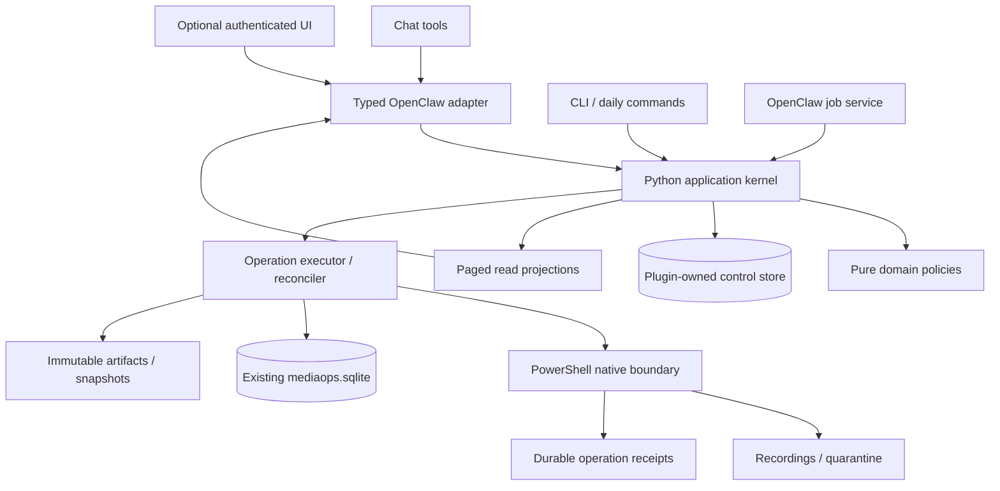
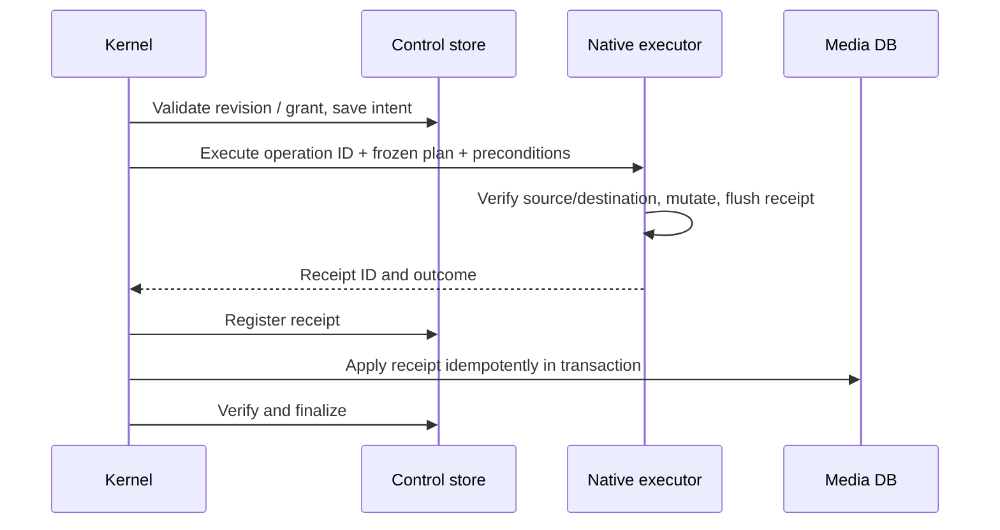

# ADR-0011: 統合アプリケーション基盤と復旧可能な操作

- Status: Proposed
- Date: 2026-10-10
- Scope: 次期設計。現在の実装仕様・承認・設定を変更しない。
- Inputs: [設計監査](../reviews/2026-10-10-design-audit.md)、[移行計画](../reviews/2026-10-10-redesign-roadmap.md)
- Builds on: ADR-0003, ADR-0008, ADR-0009, ADR-0010

## 1. 結論

プラグインを「録画整理スクリプトの集合」から、**1つの状態を持つライブラリ管理アプリケーション**へ移す。
チャット、CLI、日次実行、画面は同じコマンドと照会を利用する。
実行、レビュー、重複隔離、復元、作業データ管理を同じ制御基盤で追跡するが、各操作の承認範囲は分ける。

全面書き換えはしない。既存のドメイン判定とWindows操作を段階的に包み直し、
録画ID、配置、隔離先、復元記録を維持する。

### 利用者から見える完成形

- 「整理して」で対象範囲の棚卸しと計画まで進み、止まった理由と必要な判断が1か所に出る。
- 自動再試行できる障害は実行基盤が扱う。判断待ちは判断待ちと表示する。
- 隔離済み録画は番組・話数・理由・容量で検索できる。ハッシュ名のフォルダを開く必要はない。
- 「完了」はその実行の範囲に対する完了。ライブラリ全体の未処理・保留・未走査を隠さない。
- 中断後は何が実際に変更されたかを照合し、同じ移動を重ねて実行しない。

## 2. 守るもの / 今回作らないもの

| 維持する契約 | 内容 |
|---|---|
| 録画の同一性 | ADR-0009のfile/location identity。パス変更で別録画にしない |
| 判断の保守性 | 本放送/再放送の不明値を本放送にしない。作品・シーズン・字幕版を安易に統合しない |
| 保留 | recording holdは全経路で適用し、勝手に解除しない |
| 物理操作 | Windowsネイティブ境界、長パス、Unicode、衝突・reparse point検査を維持 |
| 重複判定 | hash完全一致と内容包含の根拠を区別。短い録画だけを理由に捨てない |
| 復元 | 既存exact-run記録とquarantine_v3配置を変更しない |
| 成果物 | cache/evidence分離、参照中の証拠を期限・件数だけで消さない |
| 公開API | 4つのV2 tool名を維持。互換adapterを通して段階導入 |

永久削除の自動化、録画エンコード、クラウド/複数ホスト同時書き込み、新しいAIプロバイダ、
既存録画の一括再分類はこの設計の対象外。AIは候補作成を助けるが、実行状態や承認の管理者にはしない。

## 3. 責務と境界



| 層 | 所有するもの | 所有しないもの |
|---|---|---|
| TypeScript adapter | SDK登録、認証済み文脈、入力schema、非同期プロセス、応答翻訳 | DB反映、gate承認、物理操作の順序 |
| Application kernel | コマンド検証、run/job/gate、承認照合、計画確定、次のaction | OpenClaw UI、LLM呼び出し固有仕様 |
| Domain | metadata、routing、identity、duplicate evidence、coverage、retention policy | ファイル移動、プロセス、UI |
| Executor / reconciler | intent、資源排他、receipt照合、DB反映、補償操作 | 作品名推測、利用者の代わりの承認 |
| Native boundary | Windowsでの観測・移動・署名検査・receipt保存 | ワークフローの承認・進捗の最終判断 |
| Query / presentation | 検索、集計、レビュー差分、短い状態表示、export | 実ファイル配置の変更 |

既存Python判定モジュールは再利用する。`py/*.py`の互換ラッパーは、呼び出し元の参照を確認してから整理する。
PowerShellの配布元はtemplatesへ一本化し、assetsは互換用途のみとする。

## 4. 状態の正本

新しい制御DBはプラグイン所有のローカルLinux state領域に置く。例:
`<pluginStateRoot>/control.sqlite`。WSLのWindowsマウント上には置かない。
OpenClawホストの共有DBを直接開く設計にはしない。

| 正本 | 保持する情報 |
|---|---|
| control.sqlite | runs、jobs、attempts、operations、gates、approvals、artifact refs、resource claims、events |
| 既存mediaops.sqlite | 録画・番組・配置・保留等のライブラリ事実。既存identityを維持 |
| Evidence store | 不変の計画、レビュー確定版、native receipt、オンラインDB snapshot |
| Cache workspace | 再生成できる中間画像・抽出結果。登録済みpolicyでのみ可逆整理 |
| 旧run.json / dedup manifest | 移行中は読取専用adapterの原本。新旧の二重書き込みをしない |

制御DB内の変更はtransactionで行い、runには単調増加の`revision`を持たせる。
更新はexpected revision一致時だけ成功させる。artifactファイルは完成・flush後に登録する。
登録前に停止した未参照ファイルはorphanとして検出し、承認済み証拠と混同しない。

### 実行排他

- 初期はライブラリ単位のwriterを1つに絞る。read-onlyの棚卸し・照会は別扱い。
- チャット、CLI、日次、復元、保管整理の全writerが同じresource claimを使う。
- job claimにはowner、attempt、lease、fencing tokenを持たせる。
- lease期限切れだけで旧Windows子プロセスを無視して再実行しない。
  native executorは全実行期間のOS排他を保持し、旧attemptの停止/照合が済むまで新しいwriterを入れない。
- Python/Windows間の排他方式は移行M3の実機試験で確定する。現行daily.lockだけを共通排他と見なさない。

media DB、control DB、filesystemを跨ぐatomic transactionは存在しない。
ここはoperation journalとreconciliationで扱い、「exactly onceで物理移動できる」とは称さない。

## 5. phase、実行状態、対象範囲を分ける

`phase`は業務段階: inventory、metadata、review、plan、apply、verify。
`executionState`は実行状態であり、phaseから機械的に導出しない。

| executionState | 意味 / 次の処理 |
|---|---|
| queued | claim待ち |
| running | leaseと実行heartbeatが確認できる |
| waiting_review | 確定対象、差分、判断者、判断後のactionを提示 |
| waiting_dependency | offline root等の理由、再確認条件、次の試行日時を保持 |
| retryable_failure | 副作用照合後にbudget内で再試行可能 |
| interrupted | 停止/プロセス喪失。まずreconcilingへ |
| reconciling | receipt、実ファイル、DBを照合中 |
| cancelling | 新規操作を止め、開始済み操作の結果を回収中 |
| succeeded | 宣言したrun scopeの処理と照合が完了 |
| partial | scope内の一部が失敗し、残りの扱いが明示されている |
| failed / cancelled | 終了理由と実際の変更分を保存。新attempt前に必要な照合を行う |

各runに`scopeSnapshot`と`coverage`を持たせる。観測済み録画は
resolved / pending_review / held / deferred / failedのいずれかに分類し、重複集計しない。
予定操作数・適用数は別の指標にする。未走査rootは録画数を0と推定せず、unknown coverageとして残す。

例えば「実行完了: 移動40本、保留12本、未走査1ドライブ」と表示する。
候補0件、最近のrun成功、1ページの表示件数だけで「全部整理済み」にしない。
旧runのactiveは新モデルのrunningに変換せず、legacyのphaseと最終観測時刻を表示する。

`nextActions`はkernelの1か所で作る。actionごとに
入力schema、実行主体、前提、期待revision、必要な承認、副作用、再試行方針を登録する。
同じ情報をCLI、skill、adapterへ別々に実装しない。

run scope固定時に、root/filter/limit、routing rules digest、metadata revision、判定policy versionを記録する。
計画後に設定や規則が変わった場合は影響を比較し、古い計画を新しい宛先で実行しない。
metadata候補はEPG/filename/既存DB/AIの由来と矛盾理由を保持する。
AI応答はschema検証したcandidateであり、confidenceだけで確定情報や承認へ昇格させない。

## 6. レビューと承認は、書き込みの前に確定する

レビュー下書きは編集可能なworkspaceとし、元抽出artifactは不変にする。
編集したYAMLのSHAを元のSHAと一致させるのではなく、import時に
元抽出への由来と許可された対象を検証し、新しい不変のreview revisionを作る。
承認はその確定版に結び付ける。

承認レコードに保持するもの:

- run、gate、確定review/plan artifact、content digest、対象scope digest。
- metadata反映 / move / quarantine / restore等の操作種別。
- 許可された対象・宛先・条件、確認した件数と容量。
- 信頼できる入口で確認したactorと承認時刻。payloadの`reviewer`だけを本人確認に使わない。

通常の利用者発言に既に含まれる承認は入口で同じgrantへ記録し、再確認を儀式化しない。
agentによるtool呼び出しや`markHumanReviewed:true`だけを、利用者の承認が存在した証拠にはしない。
同じ意味範囲で計画を再生成できる場合も、grantの条件を再検証して新digestへ明示的に関連付ける。
対象拡大、宛先変更、操作種別変更を黙って継承しない。

metadata反映の順序は必ず:

1. run/flow/phase/revision、gate、artifactの所属、確定版digest、grantを検証する。
2. 排他を取得し、変わり得る前提を再確認する。
3. operation intentと検証済みonline backupを保存する。
4. 全review対象を1つのmedia DB transactionで反映する。途中のYAMLだけを成功扱いにしない。
5. commit receiptを保存し、gateとrunを進める。

DB commit後のcontrol更新失敗も照合対象。現在のようにadapterが先にlegacy toolでDB反映し、
その後にrunを検証する構造は廃止する。
legacyの`reviewYamlPaths`入力は移行中にrun所属のdraftとして解決するだけで、直接書き込みに渡さない。

## 7. 操作の記録と中断復旧

operationは`planned -> prepared -> executing -> receipt_recorded -> db_committed -> verified`を基本とする。
不確実な副作用は`needs_reconciliation`へ移し、未実行と決め付けない。



operation IDはattemptを跨いで追跡可能にし、receiptのDB反映は一意制約で重複適用を防ぐ。
操作前には元録画identity/署名、宛先、空き容量、hold、衝突、計画digestを再検査する。
cross-volumeはcopy、内容検証、destination確定、source除去を別checkpointとして記録する。

| 停止位置 | 再開時の判断 |
|---|---|
| intent保存後、native未開始 | 前提とgrant再確認後に開始可能 |
| native処理中、receipt未取得 | native排他・process・source/destination署名を照合。盲目的に再実行しない |
| receipt保存後、DB未反映 | 同じoperation IDでDBだけを反映 |
| DB反映後、control未更新 | media側のoperation markerとreceiptでcontrolを修復 |
| copy完了、sourceも残存 | destination検証後に残りのcheckpointを扱う。別の重複判定を開始しない |
| 入力変更、衝突、照合不能 | 保留し、具体的な差分と次の判断を提示 |

復元は別の計画・grantを持つ補償操作とする。以前のDB全体を戻して、その後の別runの変更を消さない。
旧exact-run復元は専用adapterで維持し、記録にない推測操作を追加しない。

## 8. job実行とOpenClaw統合

- start/resumeは検証・job受付結果を短時間で返す。受付済みと処理完了を区別する。
- TypeScriptのGateway tool経路から`spawnSync`をなくす。SDKの非同期command実行を利用する。
- plugin serviceはcontrol storeのdurable queueを回収し、deadline、ログ上限、cancelを管理する。
- host schedulerはworkerを起こす補助。scheduler callbackや次turn injectionそのものを永続jobと見なさない。
- service停止では新規claimを止め、開始済み操作を安全なcheckpointまで回収する。
  停止できないnative processを残したまま新workerを開始しない。
- resume/retryはaccepted operationを再確認する。Gateway restartを通常の復旧手段にしない。
- 前提と既存grantを満たす非対話actionはkernelのdriverが次jobへ進める。
  人間の判断や許可範囲の変更が必要な時だけwaiting状態に入る。
- 完了・判断待ち通知は制御DBのoutboxに保存し、送信結果を記録する。
  通知の再送はevent IDで重複を抑制し、UIとstatusは通知を読まなくても現在状態を返す。
  session extensionは表示用projectionであって、jobの正本にはしない。

SDKのservice、async runtime、gateway method、session extensionを使う。
第三者プラグインで利用可能と確認できないofficial-plugin専用worker helperには依存しない。
SDKはexperimentalなので、宣言した互換hostで配布パッケージを試験し、対応範囲を実測に合わせる。

## 9. APIと利用者向けの表示

### バージョン付き内部protocol

JSON schemaを正本とし、TS/Python両端で検証する。stdoutはprotocol、stderrはbounded log。
非zero exitと成功payloadの矛盾は失敗として扱う。request/replyにはversion、request IDを必須にする。
以下は**提案例であり、現行tool入力ではない**。

```json
{
  "protocolVersion": 1,
  "requestId": "req-example",
  "command": "resume",
  "runId": "run-example",
  "expectedRevision": 12,
  "actionId": "action-example",
  "inputs": {"reviewArtifactId": "review-revision-3"},
  "approvalId": "approval-example"
}
```

authorityはadapterが別途供給する信頼済み文脈。任意のactor/path入力を認証や承認にしない。
互換toolではexpected revisionをactionから解決するが、その後の変更はkernelで拒否する。

4つのtoolは維持し、statusにoverview / runs / attention / library / quarantine / healthのqueryを追加する。
dedup、restore、maintenanceのflowは共通基盤へ移行してから公開する。
CLIは`openclaw video-pipeline <status|organize|dedup|review|quarantine|restore|artifacts|doctor>`へ整理し、
現在のCLI名は同じkernelへ委譲する互換入口として残す。

### 照会とexport

- デフォルト50件のcursor pagination。上限100件、応答予算128 KiBを設計目標とする。
  個別previewは別予算とし、大きなitemは詳細参照へ分ける。
- countsはページ外を含むsnapshot全体から計算。cursorにsnapshot revisionを含め、更新時は再取得を案内する。
- 隔離一覧は番組名、話数、ドライブ、容量、隔離理由、残す録画、復元可能性を表示する。
  hashフォルダ名とraw pathは詳細情報に下げる。
- HTMLは持ち出し用exportであり、全データを毎回embedする画面の正本にはしない。
  現行preview上限256 KiBをhostから確認し、サイズとsession境界を配信前に検証する。
- source treeは開発・配布物だけ。exportはruntime領域に保存し、配信に必要な小さいコピーだけを
  hostの認めるsession境界へ置く。任意パスを読めるように境界を広げない。

画面の構成は「概要 / 要確認 / ライブラリ / 隔離 / 実行履歴 / 設定・診断」。
一覧の検索・絞り込み・選択で実ファイルを変更しない。
「確認対象」「判断した範囲」「実際の変更」を分けて見せる。
隔離対象の一覧を開くことや表示上の選択を、削除承認にしない。

チャットとCLIの照会を先に完成させる。native UIはCustom plugin UI labが有効な場合の任意機能で、
自動有効化しない。plugin-owned gateway-auth routeとschema付きAPIで提供し、
公開static assetsへユーザーデータや証拠を混ぜない。認証済みuserの権限をUIにも適用する。

## 10. バックアップ、保管、診断

DB snapshotはSQLite online backup APIで作り、整合性検査・必要なschema/件数・digestを記録する。
backup IDは一意にする。WAL/DELETEの両モードで検証し、main DBのcopy2を成功条件にしない。
run、未解決operation、復元期間から参照されたbackupは件数ローテーションから除外する。

doctorはconfig syntax、schema version、protocol version、Windows executor、root別到達性、
backup、未照合operation、resource owner、artifact参照不整合を分けて返す。
読取専用の履歴照会まで全ドライブ接続を必須にしない。
czkawka等の依存は、そのproviderを使う機能のcapability checkで判定する。

秘密情報はconfig snapshot/log/exportへ保存しない。監査eventにはactor、action、scope、revision、
operation、結果を記録する。GUIの短い説明だけを監査証拠にしない。

## 11. 移行と受け入れ

[移行計画](../reviews/2026-10-10-redesign-roadmap.md)のM0-M5で導入する。
最初のreleaseはrun検証前の副作用、backup、lost updateを修正する。
UIを先に作って現行の状態分断を覆い隠さない。

判定条件は、同時resume、誤ったrun/gate、変更済みreview、WAL snapshot、native中断、
receipt/DB間の停止、保持すべき証拠、pagination総数、実際のpreview配信を含む。
変更がない既存録画・旧runを再実行して移行確認に使わない。

### 採用しない代案

| 代案 | 採用しない理由 |
|---|---|
| 現行CLIごとに画面を追加 | 状態、排他、承認、復旧が分断されたまま |
| 全部TypeScriptへ移植 | Pythonの判定資産を捨て、Windows境界まで同時に変える必要はない |
| 巨大HTMLを常に圧縮配信 | 静的snapshotの更新・集計・権限・host制約を解決しない |
| JSON atomic replaceだけで競合対策 | read-modify-writeのlost updateを防がない |
| 新DBへ一括移行し旧状態を削除 | 未解決gate、旧receipt、exact-run復元の検証が困難 |
| LLMに自動再開を任せる | durableなclaim、副作用照合、対象範囲の保証にならない |

## 12. 公式根拠

2026-10-10に現行公式docsを読み、ローカルOpenClaw sourceの型・scheduler契約を照合した。

- [Plugin SDK overview](https://docs.openclaw.ai/plugins/sdk-overview): experimental、互換性、機能境界。
- [SDK runtime](https://docs.openclaw.ai/plugins/sdk-runtime): 非同期command/runtime helpers。
- [Host hooks](https://docs.openclaw.ai/plugins/sdk-overview/host-hooks): session controls、UI、認証付きroute。
- [Infrastructure](https://docs.openclaw.ai/plugins/sdk-overview/infrastructure): service/state/lifecycle。
- ローカル確認: `src/plugin-sdk/plugin-entry.ts`、`src/plugins/plugin-api.types.ts`、
  `src/plugins/plugin-registration.types.ts`、`src/plugins/service-scheduler.types.ts`、
  `src/plugins/host-hooks.ts`、`src/plugins/runtime/runtime-system.ts`。

上記sourceのrootはOpenClaw checkoutであり、このリポジトリからhost内部sourceをimportする指示ではない。
